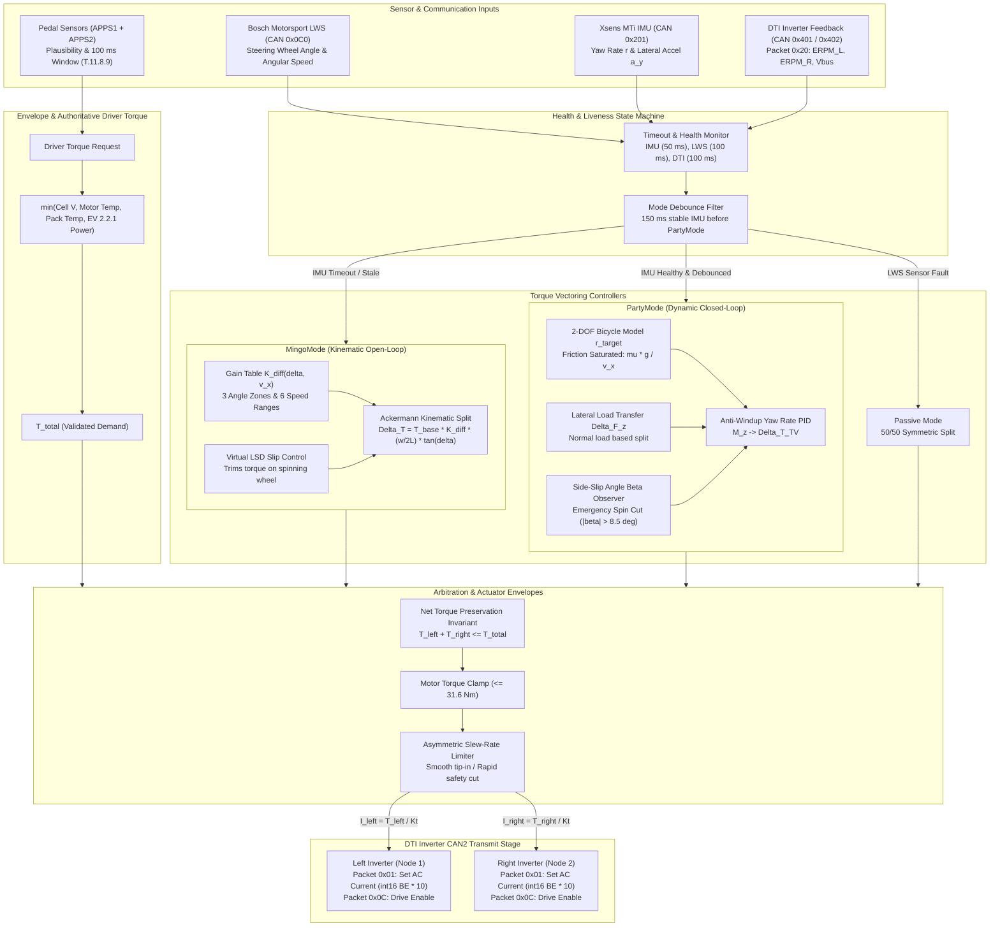

# IFS09-CE-ECU

Embedded firmware for the **ECU** of the IFS09, developed on an **STM32H733ZG** with **FreeRTOS and C++17**. It reads the driver's pedals, decides how much torque the car is allowed to make, and talks to everything else on the car over CAN. The image links at `0x08020000` and is flashed over CAN through [`stm32-can-bootloader`](https://github.com/isc-fs/stm32-can-bootloader) — there is no SWD in the normal workflow.

---

## Season 9 — Starting point

IFS09 opens from the **IFS08 season-end baseline (v2.1.1)**. All firmware, tests, tooling, and CI/CD pipelines are carried over from [`IFS08-CE-ECU`](https://github.com/isc-fs/IFS08-CE-ECU). The control core is proven and has driven the car.

**What this means for you:**

- [`HANDOVER.md`](HANDOVER.md) describes the state the code was in at the end of IFS08. Read it before opening any issue or starting any feature.
- The three open threads from IFS08 (`#132`, `#127`, `#212`) are the natural first candidates for IFS09 work.
- Version numbering resets: IFS09 starts at **v0.1.0**. The first release that drives the IFS09 car will be v1.0.0.

| If you are… | Read |
|---|---|
| **New to the team** | This page, then [`docs/derating.md`](docs/derating.md) |
| **About to flash a board** | [`docs/flashing.md`](docs/flashing.md) — including the recovery section, *before* you need it |
| **Bringing the car up** | [`docs/commissioning.md`](docs/commissioning.md) — the on-car runbook |
| **Changing code** | [`CLAUDE.md`](CLAUDE.md) — the architecture reference and the conventions |
| **Picking this up from IFS08** | [`HANDOVER.md`](HANDOVER.md) — where it was left, what is half-finished, and the traps |

Anything in [`docs/historical/`](docs/historical/README.md) describes old firmware and is kept only so old decisions stay readable. Do not trust it against the current code.

---

## Getting started

1. Create a GitHub account if you don't have one yet.
2. Download and install [GitHub Desktop](https://desktop.github.com/) (beginner) or [Git CLI](https://git-scm.com/book/en/v2/Getting-Started-Installing-Git) (advanced).

   - If this is your first time using GitHub Desktop, make sure to read the [User Manual](https://help.github.com/desktop/guides/).
   - If this is your first time using Git, start with a tutorial. There are many available online:
     - [Git Tutorial](https://git-scm.com/docs/gittutorial)
     - [Atlassian Git Tutorial](https://www.atlassian.com/git/tutorials/)
   - Keep a copy of [GitHub's Git Cheat Sheet](https://services.github.com/kit/downloads/github-git-cheat-sheet.pdf) handy as a reference.

3. Clone this repository to your machine:
   - SSH: `git@github.com:isc-fs/IFS09-CE-ECU.git`
   - HTTPS: `https://github.com/isc-fs/IFS09-CE-ECU.git`

---

## How we work with this repository

### Main branches

The repository has two permanent branches:

**`main`** is the production branch. It contains only validated code that can be flashed onto the car. Never work directly on it.

**`dev`** is the development branch. It is the integration point where everyone's work comes together. Never work directly on it either — all changes arrive through a feature branch.

```
main  ──────────────────●──────────────────────●──▶  (validated releases only)
                        ↑                      ↑
dev   ──────●───●───●───●───●───●───●───●───●──●──▶  (continuous integration)
            ↑   ↑       ↑   ↑   ↑       ↑   ↑
          feat/1 fix/1 feat/2 fix/2   feat/3 fix/3
```

### Feature branches

All work — whether a new feature or a bug fix — is done on a **feature branch** created from `dev`. When the work is ready, a Pull Request is opened toward `dev`, reviewed, merged, and the branch is deleted.

There are two branch types, each with its own independent numeric counter:

```
feat/<n>   →  new functionality  (feat/1, feat/2, feat/3 ...)
fix/<n>    →  bug fix            (fix/1,  fix/2,  fix/3  ...)
```

The `feat` and `fix` counters are independent: `feat/2` and `fix/2` can exist at the same time with no conflict.

### Tracking branch history

Feature branches are deleted after merging to keep the repository clean. The history of each branch is preserved in **GitHub Issues**.

Every branch has one associated issue. The issue carries a **label** (`feat` or `fix`) and its title includes the branch number, for example: `[feat/3] Add CAN broadcast for mission state`. When the branch is merged and deleted, the issue is closed — becoming a permanent record of all the work done.

To see which branches are currently active: filter issues by label and status `open`.
To browse the full history: filter by label and status `closed`.
The number for the next branch of each type is the last closed issue of that type plus one.

> Example: if the last closed issue with label `feat` is `[feat/4] ...`, the next feature branch will be `feat/5`.

**Two rules that are easy to get wrong and expensive to miss:**

- **`TorqueCap` must be `100` and every `Stub*` must be `false` in anything committed.** They exist for bench work on stands. All five are announced on the ungated `0x704`, so check the bus before you chase a car that feels slow.
- **Never hand-edit CubeMX-owned files outside a `USER CODE BEGIN/END` block.** A regeneration wipes anything outside them, and it has silently reset the FDCAN MessageRAM offsets more than once — which kills CAN TX outright.

`dev → main` is a **release**, not a routine merge, and is gated on full validation. Full detail in [`docs/REPOSITORY_WORKFLOW.md`](docs/REPOSITORY_WORKFLOW.md).

---

## Automation

The repository includes several GitHub Actions workflows that manage tracking issues, CI checks, and releases automatically.

### Automatic issue creation

When a `feat/*` or `fix/*` branch is pushed to GitHub, the workflow automatically opens an issue with:

- The corresponding `[feat/N]` or `[fix/N]` title
- The correct label (`feat` or `fix`)
- A template with sections for describing the work and adding notes
- The name of the developer who created the branch

### Wrong number warning

If the branch number is not the next expected one (either too low or too high), the issue will display a warning indicating the correct number and asking the developer to delete and recreate the branch with the right name.

### Auto-fill description from first commit

When the developer makes their first commit and pushes it, the workflow automatically updates the *"What does this branch do?"* section of the issue with that commit message.

- If the developer manually edits the issue before pushing their first commit, the workflow will not overwrite the description.
- The description is only updated once — subsequent commits do not modify the issue.

### Build and test CI

On every push to `feat/*`, `fix/*`, `dev`, and `main`, CI automatically:

- Compiles the **host SIL suite** and runs `ecu09_sil --test-all` (regression gate for the control core — no hardware needed)
- Cross-compiles the **firmware** for `STM32H733` with `arm-none-eabi-gcc`
- Checks the **FDCAN MessageRAM layout** for overlapping windows (the silent CAN-TX killer)
- Verifies the **flash layout** is bootloader-compatible (`0x08020000` app entry point)
- Checks the **CAN contract** against the AMS repo (requires `AMS_REPO_TOKEN` secret)

### DBC bot

On every PR to `dev` or `main`, the **dbcinator bot** regenerates [`docs/dbc/ecu.dbc`](docs/dbc/ecu.dbc) from the code-first CAN DSL and force-pushes the result onto the PR branch. Never hand-edit the DBC — the bot owns it.

### HIL test dispatch

Comment `/hil-test` on any PR to dispatch a hardware-in-the-loop run to the bench fleet. Results are posted back to the PR. Requires the `HIL` secret (a PAT scoped to `isc-fs/IFS_HIL`).

### Automatic releases

Pushing a `v*` tag to `main` triggers the release workflow: cross-compile, convert to `.bin`/`.hex`, regenerate the DBC, and publish a GitHub Release with all assets attached.

> **Repository secrets required (team admin):** `AMS_REPO_TOKEN`, `HIL`, `DBCINATOR_APP_ID`, `DBCINATOR_PRIVATE_KEY`. Without them those CI jobs skip or fail loudly — they do not silently pass.

---

## Step-by-step workflow

### 1. Create the branch

```bash
# Make sure you are on an up-to-date dev
git checkout dev
git pull origin dev

# Create your branch using the next available number for its type
# (last closed issue of that type + 1)
git checkout -b feat/5    # or fix/3, depending on that type's counter
```

> To find the right number: go to **Issues → filter by label `feat` or `fix` → sort by newest** and read the last number.

### 2. Push the branch

```bash
git push origin feat/5
```

The tracking issue will be opened automatically on GitHub within seconds.

### 3. Work and commit

```bash
# Make your changes and commit with a clear, descriptive message
git add .
git commit -m "short description of what this commit does"

# Push the changes
git push origin feat/5
```

The message of your **first commit** will be used to automatically fill in the issue description.

### 4. Open a Pull Request

When the work is ready, open a Pull Request on GitHub from your branch toward `dev`. In the PR description write `Closes #<issue-number>` so the issue closes automatically when the PR is merged.

Before requesting a review, check that:
- CI is green (SIL suite passes, firmware builds)
- You have tested the change on the bench if applicable
- `TorqueCap = 100` and all `Stub*` flags are `false` in [`Core/Inc/app/ecu_config.hpp`](Core/Inc/app/ecu_config.hpp)
- The PR targets `dev`, not `main`

### 5. Review and merge

Another team member will review the PR. Once approved, it is merged into `dev` and the branch is deleted. The issue will be closed as a permanent record.

### 6. Merging into main

When `dev` holds a set of validated changes that are ready for the car, a responsible team member opens a Pull Request from `dev` into `main`. This only happens after full firmware validation (HIL/bench). Merging `dev` into `main` triggers a release — tag the resulting commit with a semver tag (`v1.0.0`) to publish the GitHub Release with all firmware assets.

---

## What the ECU actually does

Pedals in, validated torque request derived, followed by four independent safety limits and dynamic torque vectoring across the dual independent rear motors:

```
APPS1 + APPS2 ──▶ Plausibility (T.11.8.9) ──▶ Torque Map ──┐
                                                            │
                    ┌───────────────────────────────────────┘
                    ▼
        min( Cell Voltage Cap, Motor Thermal Cap,
             Pack Thermal Cap, EV 2.2.1 Power Cap )
                    │
                    ▼ Validated Driver Request (T_total)
    ┌────────────────────────────────────────────────────────┐
    │     Electronic Differential & Torque Vectoring         │
    │  (Bosch LWS Steering + Xsens IMU + DTI ERPM Telemetry) │
    └────────────────────────────────────────────────────────┘
             │                                      │
             ▼                                      ▼
    Left Inverter (DTI Node 1)             Right Inverter (DTI Node 2)
```

Every limiter is a **cap**, never a gain — `torque = min(torque, cap)`. [`docs/derating.md`](docs/derating.md) explains all four caps and which one to suspect when the car feels down on power.

---

## Electronic Differential & Torque Vectoring (RWD)

On this branch (`feature/electronic-differential`), the ECU implements an **Electronic Differential (Torque Vectoring)** on the rear axle for dual independent DTI inverters and F-MOT motors. It takes the rule-compliant validated driver torque demand ($T_{total}$) and splits/modulates it across the left and right rear wheels to optimize cornering agility, eliminate understeer, and ensure high-speed stability.

### Control Modes & Failsafe Architecture

1. **Passive Mode (`DIFF_MODE_PASSIVE`):**
   - Symmetric 50/50 torque split ($T_{left} = T_{right} = T_{total} / 2$).
   - Active at standstill ($v_x < 0.8\text{ m/s}$) or as a safe fallback if steering angle telemetry is lost.
2. **Open-Loop Kinematic Mode (`DIFF_MODE_MINGO`):**
   - Pure feedforward Ackermann steering geometry based on road wheel angle $\delta$ and vehicle speed $v_x$:
     $$\Delta T = T_{base} \cdot K_{diff}(\delta, v_x) \cdot \left(\frac{w}{2L}\right) \cdot \tan(\delta)$$
   - Features variable gain scheduling $K_{diff}(\delta, v_x) = K_{angle}(\delta) \cdot K_{speed}(v_x)$ across 3 angle zones (deadband $<2^\circ$, linear ramp $2^\circ-22^\circ$, saturation $>22^\circ$) and 6 speed ranges ($0-15$, $15-30$, $30-42$, $42-62$, $62-82$, $>82\text{ km/h}$).
   - Includes **Virtual LSD** slip mitigation using rear-wheel ERPM telemetry to trim torque on any slipping wheel exceeding a 15% deviation threshold.
   - Functions as the immediate glitch-free fallback whenever IMU telemetry times out.
3. **Closed-Loop Dynamic Mode (`DIFF_MODE_PARTY`):**
   - 2-DOF linear bicycle model generating target yaw rate:
     $$r_{target,lin} = \left[\frac{v_x}{L + K_{us} v_x^2}\right] \delta$$
   - Saturation by available road friction: $|r_{target}| \le \min\left(|r_{target,lin}|, \frac{\mu g}{v_x}\right)$.
   - Dynamic lateral load transfer base allocation: normal load shifts from inner to outer wheel in cornering ($\Delta F_{z,rear} = \frac{m \cdot a_y \cdot h_{CG}}{w} K_{roll,rear}$), allocating more base torque to the heavily loaded outer tire.
   - Anti-windup PID controller acting on yaw rate error $e_r = r_{target} - r_{actual}$ to produce corrective yaw moment $M_z$ and torque bias $\Delta T_{TV} = \frac{M_z \cdot r_w}{G \cdot w}$.
   - Side-slip angle ($\beta$) observer ($\dot{\beta} = \frac{a_y}{v_x} - r_{actual}$) with emergency spin intervention: if $|\beta| > 8.5^\circ$, total torque is cut by 70% and stabilizing counter-yaw moment is commanded.

### Process & Data Flow Diagram



### Module Structure & Integration Reference

- **[`differential_config.h`](Core/Inc/app/differential_config.h) & [`differential_config.c`](Core/Src/app/differential_config.c):** Single point of tuning for geometry ($W, L, h_{CG}$), PID gains, gain curves, limits, and CAN IDs.
- **[`electronic_diff.h`](Core/Inc/app/electronic_diff.h) & [`electronic_diff.c`](Core/Src/app/electronic_diff.c):** Pure, deterministic C core module implementing the state machine, kinematics, bicycle model, load transfer, and arbitrator.
- **[`electronic_diff_can.h`](Core/Inc/app/electronic_diff_can.h) & [`electronic_diff_can.c`](Core/Src/app/electronic_diff_can.c):** CAN encoding and decoding layer for Bosch LWS, Xsens IMU, and DTI inverters.
- **[`ELECTRONIC_DIFF_INTEGRATION.md`](docs/ELECTRONIC_DIFF_INTEGRATION.md):** Complete step-by-step firmware integration and trackside tuning guide.

---

### The three buses

| Bus | Peer | Traffic |
|---|---|---|
| **FDCAN1** | Inverters (DTI Dual Inverter RWD / EMC) | Dual-motor torque & drive commands out, ERPM/Duty/Temp telemetry in |
| **FDCAN2** | AMS, pit tool, driverless uDV, Bosch LWS, Xsens IMU | Safety contracts (heartbeat, precharge, discharge interlock), steering angle & vehicle dynamics IMU telemetry |
| **FDCAN3** | Dashboard | TX only |

All three at 500 kbit/s. The wire format is **code-first**: the `.def` files in `Core/Inc/can/messages/` are the source of truth, and [`docs/dbc/ecu.dbc`](docs/dbc/ecu.dbc) is generated from them by the DBC bot on every PR.

---

## Build and test

```bash
# Host SIL suite (no hardware needed — the regression gate)
cmake -S . -B build-sil -DBUILD_SIL_TESTS=ON -DBUILD_UNIT_TESTS=OFF
cmake --build build-sil -j8
./build-sil/tests/sil/ecu09_sil --test-all

# Firmware cross-compile
cmake -S firmware -B build-fw && cmake --build build-fw -j8
python3 scripts/check_flash_layout.py build-fw/ECU09.elf
```

The layout check is not optional: an image that grows into sector 0 or sector 7 overwrites the bootloader or its NVM, flashes cleanly, and then never boots.

---

## Honest gaps

Constants tagged `COMMISSION` in `ecu_config.hpp` have **never been measured on this car**. They are placeholders with plausible values, not settings. [`docs/commissioning.md`](docs/commissioning.md) is the procedure for turning each one into a measurement.

If you find a sentence here that the code contradicts, **the code wins and the sentence is a bug** — fix it in the same PR.

---

*ISC Racing Team — IFS09 Control Electronics*